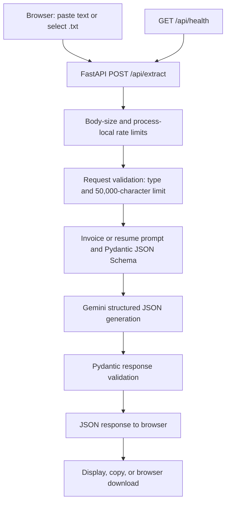

# JSON Extractor — AI Document Intelligence

JSON Extractor turns plain-text invoices and resumes into structured JSON.
The FastAPI application sends document text to Gemini for extraction, validates
the result against Pydantic schemas, and returns it to the browser for display,
copying, or download.

## Problem

Invoices and resumes use different layouts and wording. Manually transferring
their information into a consistent structure takes time and can introduce
omissions or formatting errors. A model response alone is not guaranteed to
match the exact data shape an application expects.

## Solution

This project combines task-specific extraction prompts, Gemini's structured
JSON generation, and Pydantic validation. It supports invoice and resume
documents through a same-origin web interface and a separate command-line
runner.

## Key features

- Extracts invoice details, line items, amounts, dates, and payment terms.
- Extracts resume contact details, education, work history, responsibilities,
  and skills.
- Uses explicit schemas and rejects unexpected output fields.
- Accepts pasted text or `.txt` files, up to 50,000 characters.
- Limits extraction request bodies to 350,000 bytes.
- Applies a process-local limit of five extraction requests per minute.
- Displays and downloads web results in the browser; the web application does
  not save submitted documents or extraction results on its server.
- Includes offline tests that mock extraction and do not call Gemini.

## Invoice extraction workflow

1. Select **Invoice**, then paste invoice text or choose a `.txt` file.
2. The browser sends the text to `POST /api/extract` with
   `document_type: "invoice"`.
3. The application builds an invoice-specific prompt and supplies the invoice
   JSON Schema to Gemini in JSON response mode.
4. The response is validated as an `InvoiceSchema`.
5. The browser displays the API response and can copy or download it as JSON.

## Resume extraction workflow

1. Select **Resume**, then paste resume text or choose a `.txt` file.
2. The browser sends the text to `POST /api/extract` with
   `document_type: "resume"`.
3. The application builds a resume-specific prompt and supplies the resume
   JSON Schema to Gemini in JSON response mode.
4. The response is validated as a `ResumeSchema`.
5. The browser displays the API response and can copy or download it as JSON.

## Architecture



## Technology stack

- Python 3.14.7
- FastAPI and Uvicorn
- Google Gen AI Python SDK and Gemini
- Pydantic v2
- `python-dotenv`
- pytest and FastAPI's test client

## Project structure

```text
JSON-EXTRACTOR-TOOL/
├── .env.example
├── .gitignore
├── .python-version
├── README.md
├── app.py
├── extraction.py
├── gemini_client.py
├── prompts.py
├── render.yaml
├── requirements.txt
├── run_sample_extraction.py
├── schemas.py
├── samples/
│   ├── sample_invoice.txt
│   └── sample_resume.txt
├── static/
│   ├── fonts/
│   │   └── Nunito.woff2
│   └── index.html
└── tests/
    ├── test_extraction.py
    ├── test_gemini_client.py
    ├── test_schemas.py
    └── test_web_app.py
```

## Structured JSON and Pydantic validation

The application derives JSON Schemas from `InvoiceSchema` and `ResumeSchema`
and sends them to Gemini using JSON response mode. Pydantic validates Gemini's
returned JSON, including nested invoice line items and resume education and
experience entries. Unexpected fields are rejected, invoice dates are parsed
as dates, and missing optional information uses `null` or empty collections
according to the schema.

The model output is treated as untrusted until it passes validation. A
validation failure is returned as a safe error response rather than a
successful extraction.

## Gemini structured JSON generation

The invoice and resume prompt builders define separate extraction rules,
fictional examples, and instructions to treat the supplied document as data
rather than instructions. The application passes the matching Pydantic-derived
JSON Schema separately to Gemini. Gemini access is required for live
extraction; automated tests use mocks and do not make network requests.

The Gemini client reads `GEMINI_API_KEY` and `GEMINI_MODEL` from the process
environment. A local `.env` file may be loaded for development, without
overriding values already set in the environment.

## FastAPI endpoints

| Method | Path | Purpose |
|---|---|---|
| `GET` | `/` | Serves the web interface. |
| `GET` | `/static/{path}` | Serves static assets, including the local font. |
| `GET` | `/api/health` | Returns service status without contacting Gemini. |
| `POST` | `/api/extract` | Validates and extracts invoice or resume data. |

### `POST /api/extract`

Request JSON:

```json
{
  "document_type": "invoice",
  "document_text": "Invoice INV-42. Supplier: Example Office. Total: $25.00."
}
```

`document_type` must be `invoice` or `resume`. `document_text` must contain
non-whitespace text of no more than 50,000 characters. Request bodies larger
than 350,000 bytes receive `413`. The process-local extraction limit returns
`429` when reached. Invalid request data returns `422`; Gemini, empty-response,
or model-validation failures return a safe `502`; unexpected failures return a
generic `500`.

Successful response shape:

```json
{
  "document_type": "invoice",
  "data": {
    "invoice_number": "INV-42",
    "invoice_date": null,
    "due_date": null,
    "supplier_name": "Example Office",
    "supplier_address": null,
    "supplier_email": null,
    "bill_to_name": null,
    "bill_to_address": null,
    "line_items": [],
    "subtotal": null,
    "tax_amount": null,
    "total_due": 25.0,
    "currency_symbol": "$",
    "payment_terms": null
  }
}
```

The returned extraction fields depend on the input document; this example is
illustrative, not a guarantee of extraction content.

## Local installation

These commands use PowerShell on Windows from the project directory. Python
3.14 is expected; `.python-version` specifies 3.14.7.

```powershell
py -3.14 -m venv .venv
.\.venv\Scripts\python.exe -m pip install -r requirements.txt
```

## Environment variables

Create a local `.env` file from the placeholder template:

```powershell
Copy-Item .env.example .env
```

Set your own values in `.env` locally:

```text
GEMINI_API_KEY=your_gemini_api_key_here
GEMINI_MODEL=your_gemini_model_here
```

Use a Gemini model name available to your Google AI account. Never commit
`.env` or put a real key in source code, documentation, screenshots, or issue
reports. `.env.example` contains placeholders only, and `.env` is ignored by
Git. In deployment, set both variables in Render's environment settings rather
than relying on a committed `.env` file.

## Local execution

Run the web application:

```powershell
.\.venv\Scripts\python.exe -m uvicorn app:app --reload
```

Open `http://127.0.0.1:8000/`. The API health check is at
`http://127.0.0.1:8000/api/health`.

The separate CLI makes a live Gemini request and can write output locally:

```powershell
.\.venv\Scripts\python.exe run_sample_extraction.py --type invoice
.\.venv\Scripts\python.exe run_sample_extraction.py --type resume
```

By default, the CLI reads the matching sample under `samples/` and writes
validated JSON under `outputs/`. Those generated output files are ignored by
Git. The web application instead creates JSON downloads in the browser.

## Example API requests

Invoice:

```powershell
$body = @{
  document_type = "invoice"
  document_text = "Invoice INV-42. Supplier: Example Office. Total: `$25.00."
} | ConvertTo-Json
Invoke-RestMethod -Uri http://127.0.0.1:8000/api/extract -Method Post -ContentType "application/json" -Body $body
```

Resume:

```powershell
$body = @{
  document_type = "resume"
  document_text = "Rae Example. Skills: writing and research."
} | ConvertTo-Json
Invoke-RestMethod -Uri http://127.0.0.1:8000/api/extract -Method Post -ContentType "application/json" -Body $body
```

Both examples call Gemini when executed against a running application with
valid credentials. They are documentation examples, not automated tests.

## Automated testing

Install the requirements, then run the test suite from the project root:

```powershell
.\.venv\Scripts\python.exe -m pytest -v
```

Tests cover schemas, prompt and extraction behavior, Gemini client
configuration, web endpoints, size validation, rate limiting, and generic
exception handling. Gemini calls are mocked; tests run offline.

## Deploy to Render (Free)

The root `render.yaml` configures a standalone Render Python web service:

- **Plan:** Free
- **Build command:** `pip install -r requirements.txt`
- **Start command:** `uvicorn app:app --host 0.0.0.0 --port $PORT`
- **Health-check path:** `/api/health`
- **Python version:** 3.14.7, selected by `.python-version`

To deploy:

1. Push this project to its own GitHub repository.
2. Sign in to Render and connect the GitHub account.
3. Choose **New +** > **Blueprint**, select this standalone repository, and
   review the `json-extractor` service configuration from `render.yaml`.
4. Select the Free plan and apply the Blueprint.
5. In the Render service's **Environment** settings, add `GEMINI_API_KEY` and
   `GEMINI_MODEL` with values configured for your account. Do not put secret
   values in `render.yaml` or GitHub.
6. Wait for the service to deploy. Visit `/` for the interface and
   `/api/health` to confirm that the web process responds. The health endpoint
   does not verify Gemini credentials; test extraction separately with
   non-sensitive sample text.

The free Render instance may sleep after inactivity, so the first request
after a quiet period can take longer. Free-tier limits and behavior can
change; consult Render's current plan terms.

## Privacy and security

- The application accepts plain-text input only and enforces a 50,000-character
  document limit. Submitted text is sent to Gemini for processing.
- The web application does not persist user documents or extraction results.
  Browser JSON downloads are created client-side. The separate local CLI can
  write output files on the machine where it is run.
- No database or persistent server-side document storage is used. Do not send
  sensitive documents unless you have reviewed the applicable data-handling
  terms for Gemini, Render, and the browser/device in use.
- Extraction requests are limited to five per minute for the entire application
  process. The application does not trust arbitrary `X-Forwarded-For` values
  for client identity.
- The in-memory rate limiter resets when the process restarts, may be shared
  among users of a process, and does not coordinate across multiple instances.
  It is not distributed protection.
- Request bodies are capped at 350,000 bytes. Unexpected server errors return
  generic messages; the application does not log document text or API keys.
- Keep `.env`, virtual environments, caches, and generated output JSON out of
  Git. Only placeholders belong in `.env.example`.

## Current limitations

- Input is plain text or `.txt` only. PDF and Word parsing and OCR are not
  implemented.
- A document may contain at most 50,000 characters.
- Live extraction requires Gemini API access, a configured key, and a model
  available to the account.
- Results depend on the input and model output. Schema validation checks
  structure and types; it does not guarantee factual correctness.
- The process-local rate limiter is not distributed protection.
- Free Render instances may sleep after inactivity and use ephemeral storage.
- The web application does not persist user documents or extraction results.
